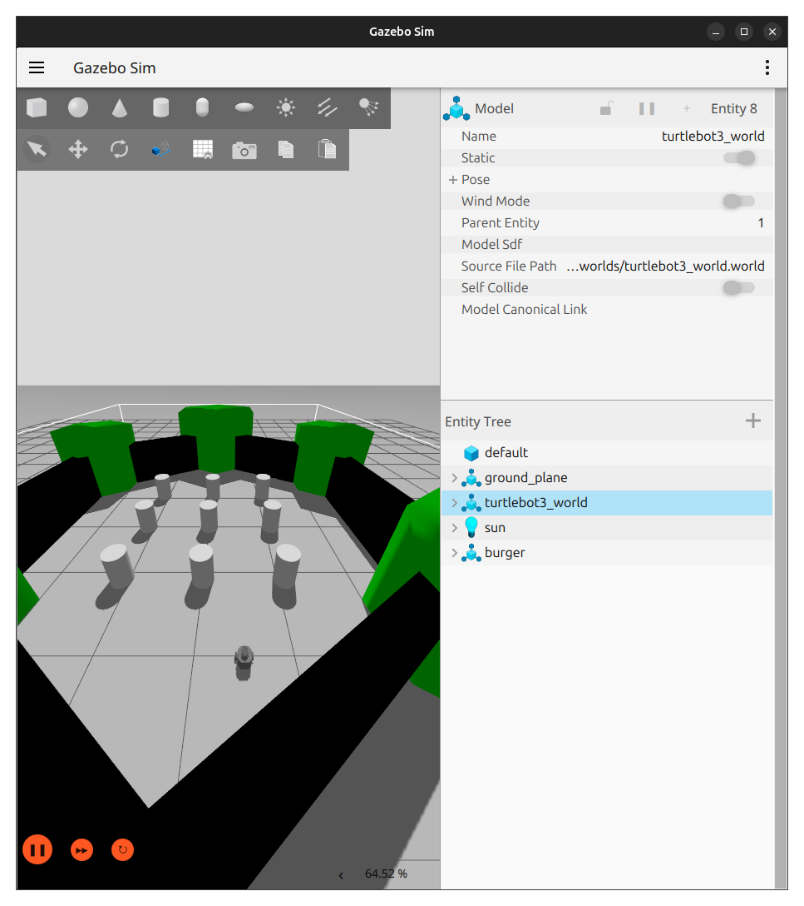
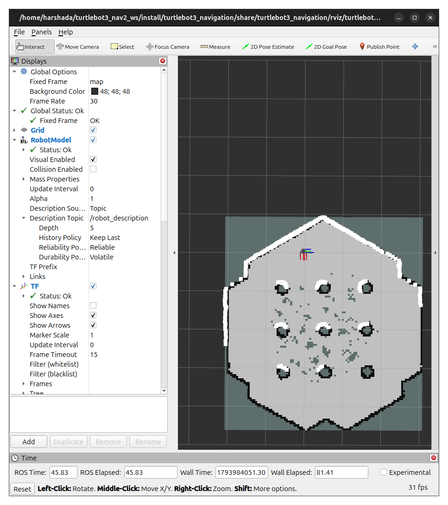

# TurtleBot3 Autonomous Navigation using ROS 2 and Nav2

## Overview

This project implements autonomous navigation of a TurtleBot3 Burger robot in a Gazebo simulation environment using ROS 2 Jazzy and the Navigation2 (Nav2) framework.

The robot can build an environment map using SLAM Toolbox, localize itself on a saved map using AMCL, and navigate to user-defined goals. A custom waypoint navigation node enables the robot to execute a sequence of navigation goals autonomously.

## Features

- TurtleBot3 Burger simulation in Gazebo.
- Environment mapping using SLAM Toolbox.
- Map saving and loading.
- Robot localization using AMCL.
- Autonomous navigation using Nav2.
- RViz2 visualization.
- Custom sequential waypoint navigation using the Nav2 `NavigateToPose` action.

## Technologies Used

- Ubuntu
- ROS 2 Jazzy
- Gazebo
- TurtleBot3 Burger
- SLAM Toolbox
- Navigation2 (Nav2)
- AMCL
- RViz2
- Python
- C++

## Repository Structure

```text
turtlebot3_nav2_ws/
├── media/
│   ├── images/
│   │   ├── gazebo_simulation_latest.png
│   │   └── rviz2_navigation.png
│   └── videos/
│       └── waypoint_navigation_demo.webm
├── src/
│   └── turtlebot3_navigation/
│       ├── config/
│       │   └── burger.yaml
│       ├── launch/
│       │   ├── turtlebot3_slam.launch.py
│       │   └── turtlebot3_nav2.launch.py
│       ├── maps/
│       ├── rviz/
│       ├── turtlebot3_navigation/
│       │   └── waypoint_navigator.py
│       ├── package.xml
│       └── setup.py
└── README.md
```

## Installation and Build

Clone the repository:

```bash
git clone <YOUR_GITHUB_REPOSITORY_URL>
cd turtlebot3_nav2_ws
```

Source ROS 2 Jazzy:

```bash
source /opt/ros/jazzy/setup.bash
```

Set the TurtleBot3 model:

```bash
export TURTLEBOT3_MODEL=burger
```

Install dependencies:

```bash
rosdep install --from-paths src --ignore-src -r -y
```

Build the workspace:

```bash
colcon build
source install/setup.bash
```

## Running the Project

### 1. SLAM Mapping

Launch the simulation and SLAM:

```bash
ros2 launch turtlebot3_navigation turtlebot3_slam.launch.py
```

Use keyboard teleoperation to explore the environment and create a map. Save the map when mapping is complete.

### 2. Autonomous Navigation

Launch Gazebo, AMCL, Nav2 and RViz2:

```bash
ros2 launch turtlebot3_navigation turtlebot3_nav2.launch.py
```

Set the robot's initial pose in RViz2 using **2D Pose Estimate**, then send navigation goals using **Nav2 Goal**.

### 3. Sequential Waypoint Navigation

Run the custom waypoint navigation node:

```bash
ros2 run turtlebot3_navigation waypoint_navigator
```

The node sends multiple navigation goals sequentially through the Nav2 `NavigateToPose` action and reports the completion status of each waypoint.

## Simulation Screenshots

### Gazebo Simulation



### RViz2 Navigation



## Waypoint Navigation Demonstration

[Watch the waypoint navigation demonstration](media/videos/waypoint_navigation_demo.webm)

## Project Status

The project has successfully demonstrated simulation, SLAM-based mapping, AMCL localization, Nav2 autonomous navigation, and sequential waypoint execution.

## License

This project is licensed under the Apache License 2.0.
